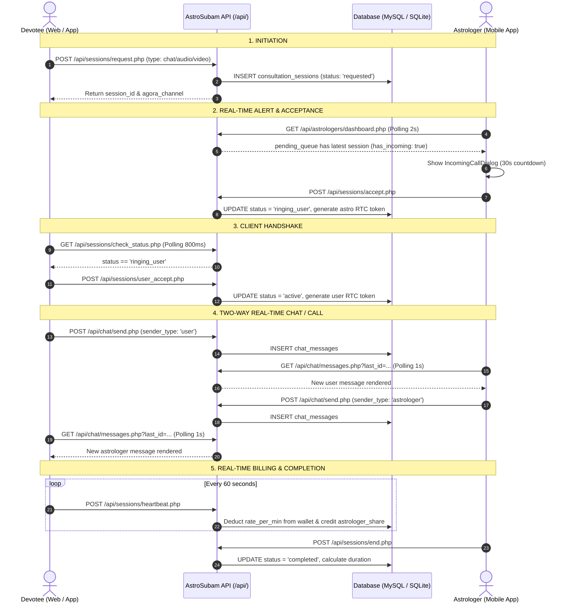

# 🌟 ASTROSUBAM - DEVELOPER & ARCHITECTURE GUIDE

This document serves as the single source of truth for the AstroSubam codebase so that any future feature additions, bug fixes, or code edits can be made effortlessly.

---

## 🏛️ System Architecture

AstroSubam operates on a high-reliability, 2-tier architecture:
1. **Frontend**:
   - **Devotee Web Portal**: Single-page, responsive Web application located in [index.php](file:///c:/xampp/htdocs/astrosubam.com/index.php) (Vanilla JS + Tailwind CSS + Lucide Icons).
   - **Astrologer & Devotee Mobile App**: Cross-platform Flutter Application in [flutter_app/lib/main.dart](file:///c:/xampp/htdocs/astrosubam.com/flutter_app/lib/main.dart).
2. **Backend**:
   - **REST API**: Modular PHP 8.x backend under `/api/`.
   - **Database**: Dual-engine PDO support with seamless fallback (Live MySQL on Hostinger and local SQLite for rapid offline development).
   - **Deployment**: Zero-downtime automated FTP sync via [deploy_ftp.php](file:///c:/xampp/htdocs/astrosubam.com/deploy_ftp.php).

---

## 📂 Directory Structure & Key Files

| Folder / File | Responsibility | How to Edit |
|---|---|---|
| [index.php](file:///c:/xampp/htdocs/astrosubam.com/index.php) | Devotee Web Portal UI, Wallet, Astrologer Listing, Call & Chat Modals | Search for `openChatModal`, `openCallModal`, or `startConsultation`. |
| [flutter_app/lib/main.dart](file:///c:/xampp/htdocs/astrosubam.com/flutter_app/lib/main.dart) | Flutter Mobile App (Auth, Astrologer Dashboard, Active Consultation, Incoming Alert) | State managers: `AstrologerState`, `UserState`. Screens: `AstrologerDashboardScreen`, `AstrologerActiveConsultationScreen`. |
| [api/sessions/](file:///c:/xampp/htdocs/astrosubam.com/api/sessions/) | Consultation Session Handshake (`request.php`, `pending.php`, `accept.php`, `user_accept.php`, `check_status.php`, `heartbeat.php`, `end.php`, `reject.php`) | Handles session creation, Agora token generation, status transitions, and wallet billing. |
| [api/chat/](file:///c:/xampp/htdocs/astrosubam.com/api/chat/) | Real-time Chat (`send.php`, `messages.php`) | Handles bidirectional message dispatch, incremental fetching (`last_id`), and DB persistence. |
| [api/astrologers/](file:///c:/xampp/htdocs/astrosubam.com/api/astrologers/) | Astrologer Profile & Metrics (`dashboard.php`, `list.php`, `detail.php`, `update_status.php`) | Real-time pending queue calculation, today's earnings, and wallet balances. |
| [config/database.php](file:///c:/xampp/htdocs/astrosubam.com/config/database.php) | Database Connection | Configures Hostinger MySQL credentials with automatic SQLite fallback. |
| [helpers/Response.php](file:///c:/xampp/htdocs/astrosubam.com/helpers/Response.php) | Standard JSON Response Formatter | Handles `getJsonInput()` supporting both raw JSON payload (`php://input`) and standard POST form-data. |
| [deploy_ftp.php](file:///c:/xampp/htdocs/astrosubam.com/deploy_ftp.php) | Live Deployment Script | Run `php deploy_ftp.php` to push all files to Hostinger server in one click. |

---

## 🔄 Core Call & Chat Workflow (100% Verified)



---

## 🛠️ How to Edit & Deploy (Cheat Sheet for Next Time)

### 1. Editing Web Features (HTML / CSS / JS)
- Edit `index.php`.
- Test locally on `http://localhost/astrosubam.com/` (or via XAMPP).
- Deploy to production:
  ```powershell
  php deploy_ftp.php
  ```

### 2. Editing Mobile App Features (Flutter)
- Edit `flutter_app/lib/main.dart`.
- Run tests to ensure nothing breaks:
  ```powershell
  cd flutter_app
  flutter test
  ```
- Build fresh release APK:
  ```powershell
  flutter build apk --release
  ```
- Copy and push to production:
  ```powershell
  cd ..
  Copy-Item -Path "flutter_app\build\app\outputs\flutter-apk\app-release.apk" -Destination "AstroSubam.apk" -Force
  php deploy_ftp.php
  ```

### 3. Testing Backend Workflows
- All test scripts can be executed via PHP CLI directly:
  ```powershell
  php -r "require 'config/database.php'; echo 'DB OK';"
  ```

---

## 🔒 Astrologer Demo Test Numbers
- **Guruji S. Sundaramurthy (ID: 1)**: Mobile: `9876543210`
- **Dr. K. Jayalakshmi (ID: 2)**: Mobile: `9876543211`
- **Acharya Ramanan Sarma (ID: 3)**: Mobile: `9876543212`
